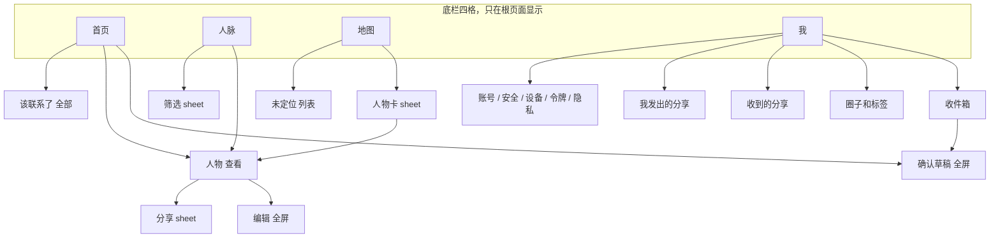
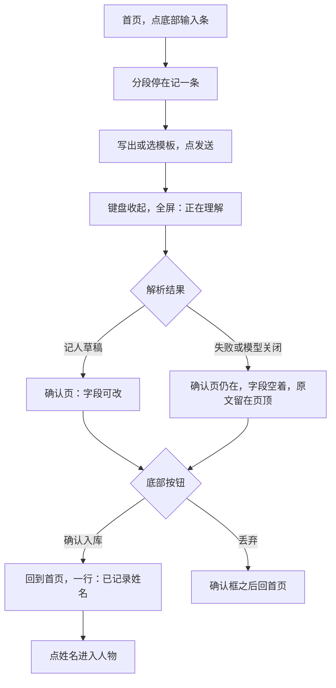
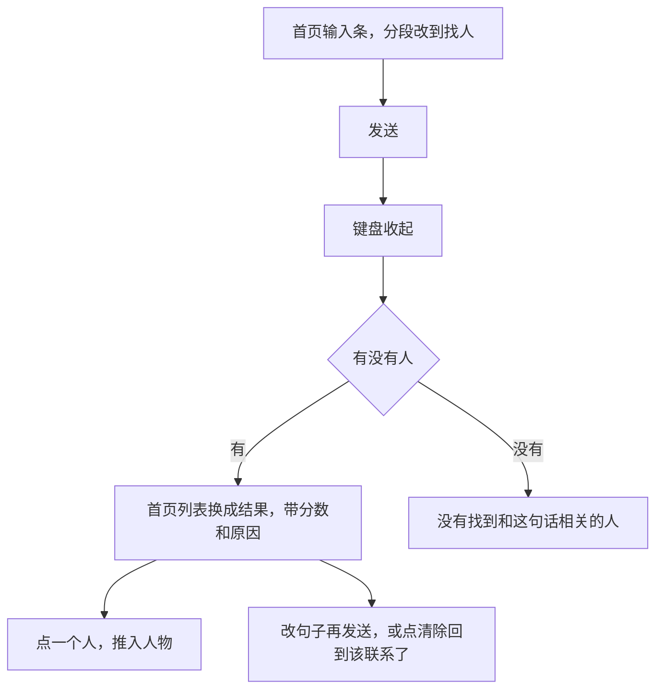
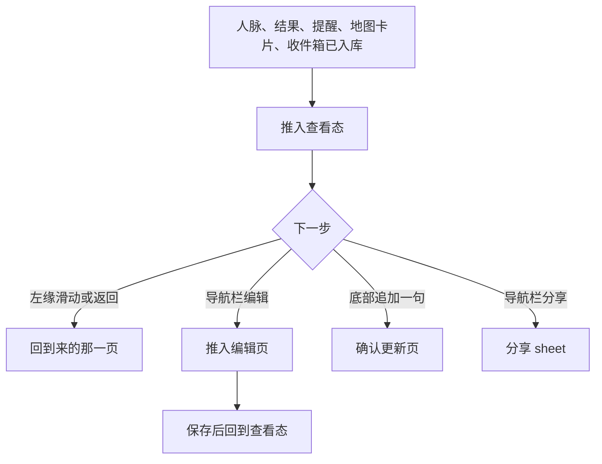
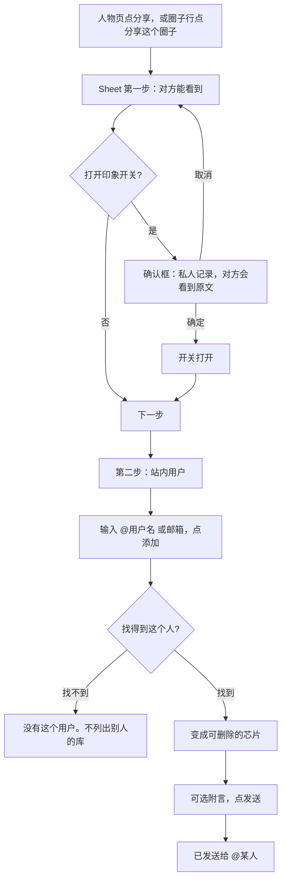
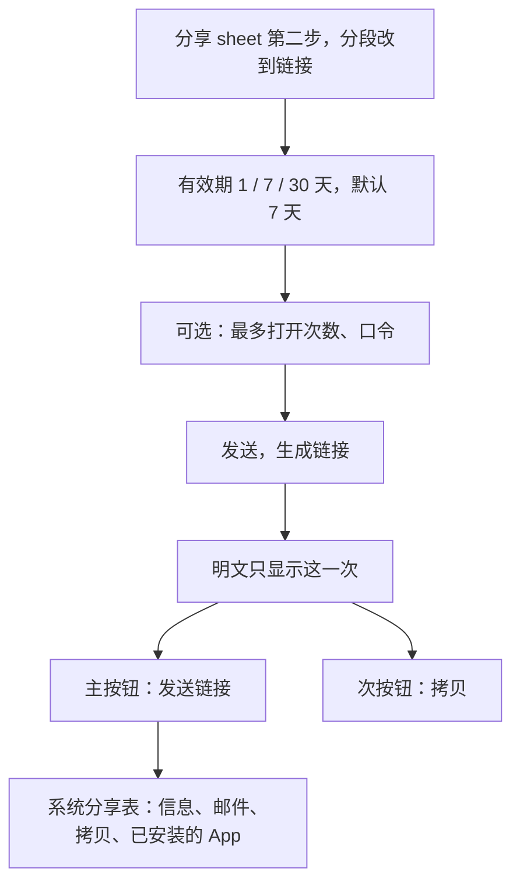
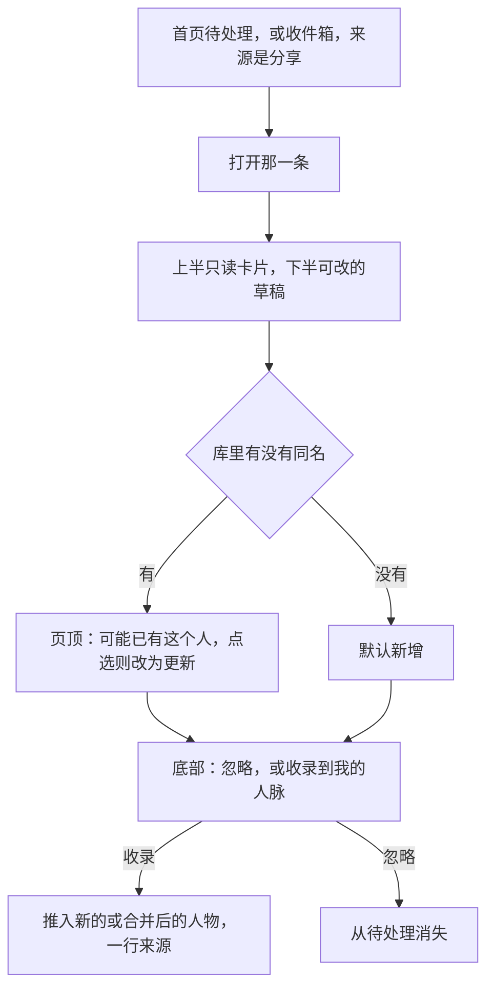
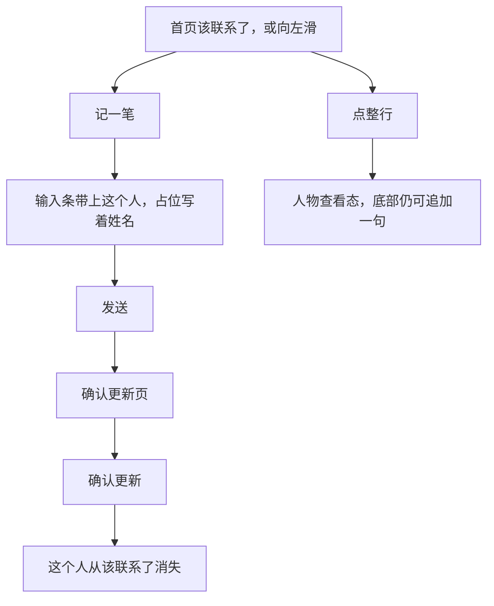
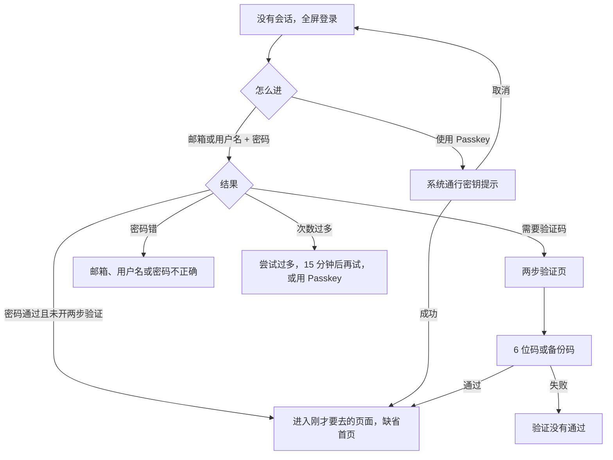
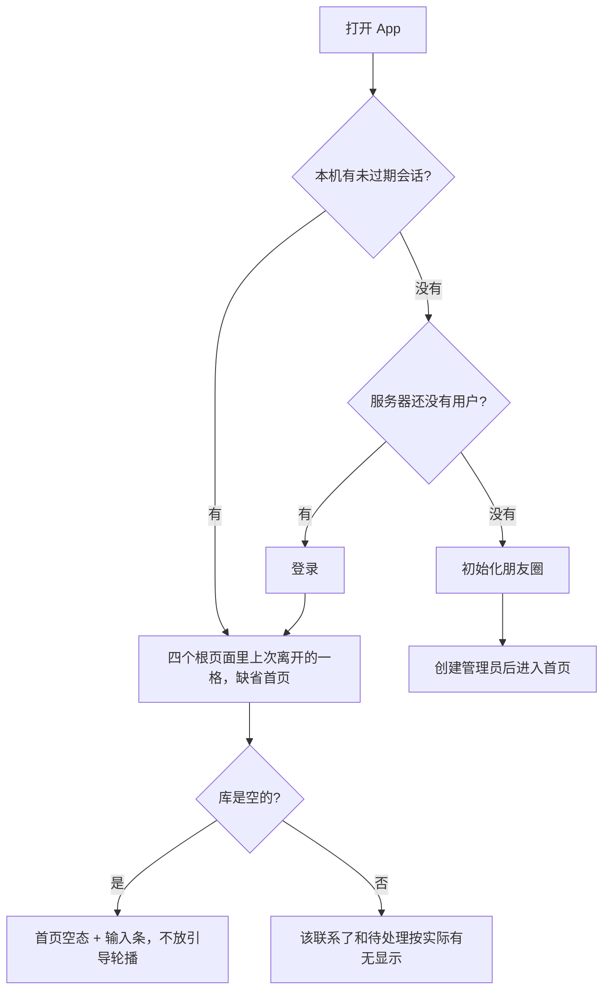

# TokenConnection iOS 界面设计

> 状态：设计稿 v0.1。只定手机上的界面和交互，不选实现技术，不改接口。
> 本文把 iPhone 当作主人脉客户端来设计：单手、拇指热区、系统手势。不是把现有网页缩到 390pt。
> 文中的「I-xx」是本文的决策编号，与 `docs/design.md` 的「D-xx」、`docs/multi-user-design.md` 的「M-xx」并列。

线框图按 iPhone 逻辑宽度约 390pt 排，一列，没有桌面三栏。

---

## 0. 文档状态与覆盖关系

### 0.1 本文细化或取代哪些已有结论

| 已有文档 | 位置 | 本文怎么处理 |
| --- | --- | --- |
| `docs/design.md` | §11 前端「移动端优先，桌面是放大版」；结果都在原地展开、不跳页 | **手机侧取代**。桌面网页保持原地展开。手机上：找人结果仍留在首页；记人草稿改为全屏确认页，主按钮固定在底部（I-04） |
| `docs/design.md` | §12「确认动作留在 web，手机只负责记下来」 | **有 App 之后取代确认发生的地方**。快捷指令仍然只提交原文。确认改在 App 里完成，因为手机上现在有足够大的确认页（I-16） |
| `docs/design.md` | §14.1 五环按关系远近、扇区按圈子 | **不把这张图写成现状**。已上线的 `/map` 是关系网：力导向，同圈子用虚线相连，四道虚线环只是尺度装饰（`src/components/map/network-map.tsx`）。手机沿用这张图。要不要改回五环，见 §13 Q1 |
| `docs/design.md` | §17 阶段 3、§19 问题 6（Swift 还是 Expo） | **不回答技术选型**。交互按 iOS Human Interface 来写，SwiftUI 或 Expo 都能照着做。原生能力边界见 §11 |
| `docs/design.md` | §2 非目标「多用户、团队协作」 | 已被多用户设计取代。本文继续：**不做**多人一起改同一条记录 |
| `docs/multi-user-design.md` | §10.3 手机底栏四格、§10.6 手机线框、§10.7 PWA | **细化**。四格的名字保留。首页装什么、角标打在哪、详情怎么编辑、分享表怎么分步，以本文为准 |
| `docs/multi-user-design.md` | §1.2「iOS 原生客户端仍是原设计阶段 3」 | 本文就是那一件事的界面规格。认证和分享的数据规则仍以多用户设计为准 |

不改 `docs/design.md` 和 `docs/multi-user-design.md`。

### 0.2 对照时以哪份为准

界面文案、字段、空态句子，以现在的页面为准，不按尚未落地的线框发明功能。下面这些文件是本文的事实来源：

| 事实 | 文件 |
| --- | --- |
| 底栏四格、桌面多一格「分享」 | `src/components/app-nav.tsx` |
| 首页只有输入框和最多 5 条待处理 | `src/app/(app)/page.tsx` |
| 「该联系了」在人脉列表底部，最多 5 人，其余在 `/reminders` | `src/app/(app)/people/page.tsx`、`src/app/(app)/reminders/page.tsx` |
| 人物查看 / 编辑切换；追加一句只在编辑态 | `src/app/(app)/people/[id]/page.tsx`、`src/components/profile-modes.tsx` |
| 关系网与地理、点按后的底部卡片 | `src/app/(app)/map/page.tsx`、`src/components/map/network-map.tsx`、`src/components/map/geo-map.tsx`、`src/components/map/person-popover.tsx` |
| 分享字段与默认开关 | `src/components/share-panel.tsx`、`src/lib/shares/snapshot.ts` |
| 收件箱来源：网页 / 快捷指令 / iOS / 分享 | `src/components/inbox-pending-list.tsx`、`src/lib/schemas/enums.ts` |
| 颜色、字体、圆角 | `src/app/globals.css`、`src/app/layout.tsx` |
| 品牌名「朋友圈」、快捷指令只记不确认 | `src/app/layout.tsx`、`shortcuts/README.md` |

### 0.3 现在的手机网页，和本文要改的地方

现状宽度在 `md` 以下走底栏（`src/app/(app)/layout.tsx` 给主内容 `pb-24`，底栏 `fixed`）。下面是设计师要改的差异，后面各节按这个表展开。

| 画面 | 现在手机上 | 本文 |
| --- | --- | --- |
| 底栏 | 首页、人脉、地图、我。角标在「我」上，数字是全部待处理 | 四格不变。角标改到「首页」。二级页面隐藏底栏 |
| 首页 | 标题写成「人脉」，和人脉 Tab 重名。输入框在页面上方并自动聚焦。没有「该联系了」 | 大标题「朋友圈」。输入条贴在底栏上方，不自动聚焦。「该联系了」放在输入条上面的第一块内容 |
| 人脉 | 筛选两列挤在一起，列表每页 8 条用页码，页底才是「该联系了」 | 人脉只负责翻库和筛选。提醒不再重复出现。滑到底加载，不用页码 |
| 人物 | 内容区自己画「‹ 人脉列表」。分享、编辑、删除挤在姓名右侧。点编辑后整页换成一张长表单，追加一句也只在这张表单里 | 系统返回。查看态是默认。编辑是后推入的分组页。追加一句在查看态底部 |
| 地图 | 关系网没有缩放，和页面一起滚动。地理图自己吃掉触摸（`touch-none`），下面又接着「未定位」长列表，拖动和滚动抢手指 | 地图占满标题和底栏之间，页面本身不滚。两种图都能捏合、拖动。未定位改成单独一页 |
| 分享 | 底部一块长表单，勾选、收件人、链接混在一屏，`window.confirm` 确认印象 | 分两步的底部 sheet。链接生成后交给系统分享表 |
| 设置子页 | 内容区再画一条「‹ 我」 | 只用导航栏返回 |
| 按钮 | 默认高 32pt，小按钮 28pt，最小图标 24pt（`src/components/ui/button.tsx`） | 可点区域至少 44×44pt |

---

## 1. 目标与非目标

### 1.1 目标

1. 主人在 iPhone 上能完成每天的两件事：用一句话把人记进去，用一句话把人找出来。从打开到发出这句话，拇指不用够到屏幕上沿。
2. 记下来之后能在手机上对完草稿再入库。快捷指令继续负责「从别的 App 丢一句话进来」；对草稿是 App 的事。
3. 已有的库都能用：人物、时间线、关系远近、圈子和标签、关系网、地理图、「该联系了」、收件箱。
4. 已落地的多用户能力在手机上可用：登录、邀请注册、每人一份人脉、只读分享、收录、账号、密码、Passkey、两步验证、登录设备、个人访问令牌、隐私开关。
5. 布局、文案、颜色沿用现在的「朋友圈」：简体中文、私密人脉库、关系远近用英文原名。

### 1.2 非目标

- 多人同时编辑同一条人物。分享仍是只读快照，收录是在自己库里另起一条（M-01、M-09）。
- 推送通知、短信、Web Push、APNs。分享到达只在打开 App 后出现在待处理里（多用户设计 §1.2）。
- 从微信或系统通讯录批量导入（D-09）。
- 人与人之间的「谁认识谁」连线。关系网上的虚线表示「同一个圈子」，不是介绍关系（D-02，`network-map.tsx` 注释）。
- 改时间线原文。事件只能追加和删除（`docs/design.md` §19 问题 1，`src/components/timeline.tsx`）。
- 给「该联系了」做推迟、静音（`docs/design.md` §14.3）。
- iPad 分栏、Mac、Apple Watch、桌面端新导航。iPhone 横屏也不做，见 I-12。
- 在本文里选择 Swift 或 Expo，或规定新的接口字段。

### 1.3 为什么按「手机主客户端」而不是缩小网页

现有网页是一条从上往下的长页，底栏只是把桌面顶栏换成了四个图标。输入框在顶上并 `autoFocus`（`src/components/universal-input.tsx`），一打开键盘就把「待处理」盖住。人物页的返回是内容里的文字链接，和系统边缘滑动不是同一套。

手机上每天要按的东西必须在拇指够得到的下半屏：输入条、发送、确认入库、底栏。看的东西放在上半屏，随滚动让开。能用系统返回、系统分享表、系统 Passkey 提示的，不自己做第二套。

---

## 2. 和现有 Web / PWA 的关系

### 2.1 PWA 继续留着

PWA 不拆除。`src/app/manifest.ts` 的「添加到主屏幕」仍然是没装 App 时的手机入口，也是桌面浏览器的同一套页面。

| 谁在用 | 用什么 |
| --- | --- |
| 装了 App 的主人 | App 是每天记人、找人、看地图、处理草稿的地方 |
| 没装 App、或在电脑前 | 现有网页 / PWA，交互以 `docs/multi-user-design.md` §10 为准 |
| 打开分享链接的访客 | 先是网页 `/s/[token]`。手机已装 App 时，系统可以用通用链接打开 App（§7.16） |
| 管理员在手机上建邀请 | App 的「我」里保留现在已有的「用户」「邀请」。审计和实例设置网页上有路由，但「我」页没有入口（`src/app/(app)/settings/page.tsx`），App 同样不新做入口 |

Safari 里的登录和「添加到主屏幕」的登录不是同一个 cookie 罐子；App 再是第三个会话。三处都要各自登录一次。这句话写在登录页的辅助说明里，避免用户以为网页已经登录、App 却要再输密码是故障（多用户设计 §10.7 已有同样事实）。

### 2.2 只在 App 里认真做的流程

这些流程网页上已经有对应能力，App 用系统界面来做，不在网页里复制一套原生控件：

| 流程 | App 里怎么出现 | 网页继续做什么 |
| --- | --- | --- |
| Passkey | 系统的通行密钥提示（Face ID / 触控 ID） | Safari 里已有的按钮继续可用 |
| 把分享链接发出去 | 生成链接之后打开系统分享表 | 现在是一块只读输入框，用户自己复制 |
| 从别的 App 记一句 | 仍是「快捷指令」App，不在本 App 里重做一套捷径编辑器 | 令牌在「设置 › API 令牌」创建，App 里同一页 |
| 地图的捏合和拖动 | 地图视图独占手指 | 现有 SVG 继续给浏览器 |
| 选照片或拍照 | 系统相册 / 相机。限制与网页相同：jpg、png、webp、gif，不超过 4MB | 输入框上的图片按钮 |

### 2.3 两端必须一致的产品规则

- 一句自然语言进收件箱，解析成草稿，人点了才入库。App 提交时 `source` 用已有枚举值 `ios`；快捷指令仍是 `shortcut`（`src/lib/schemas/enums.ts`）。
- 印象默认不出现在列表里，只在人物详情出现（`docs/design.md` §19 问题 4，`src/components/person-card.tsx`）。
- 分享默认含姓名、性别、所在地、全部标签、认识方式、认识日期、显示分享者名字。联系方式、摘要、印象、时间线、关系远近默认关（`src/lib/shares/snapshot.ts` 的 `DEFAULT_SHARE_FIELDS`）。
- 印象要放进分享时，必须先经过一句确认。
- 撤销分享不会收回对方已经收录的副本。
- 跨库访问在界面上就是「没有这个人」，不出现「无权查看」。

---

## 3. 视觉与语气

不换品牌。App 图标继续用现在的同心圆标记：描边 `#6a2c3c`，见 `src/components/app-nav.tsx` 的 `BrandMark`。

### 3.1 字体与颜色

| 项 | 取值 | 来源 |
| --- | --- | --- |
| 字体 | 系统字体，简体中文走苹方。不加载网络字体 | `src/app/globals.css` 的 `--font-sans` |
| 页面底 | 浅色近白，字近黑。深色用 `.dark` 里已有的中性色 | `globals.css` 的 `:root` 与 `.dark` |
| 主按钮 | 近黑底、近白字。不另做一枚品牌色按钮 | `--primary` |
| 危险 | 现有的 destructive 红，用于删除、撤销、丢弃 | `--destructive` |
| 圆角 | 控件约 10pt，卡片 16pt，底部 sheet 上沿 20pt | `--radius: 0.625rem`，页面里的 `rounded-xl`、`rounded-t-2xl` |
| 关系远近色 | Best Bros 玫红、Close friends 橙、Friends 琥珀、Interacted contacts 蓝、People I know of 灰 | `src/components/tier-badge.tsx`、`network-map.tsx` 的 `TIER_COLOR` |

正文用 17pt。网页上大量 14px / 12px 只留给辅助信息（时间、来源、阈值）。姓名最多两行，不缩成小一号来硬塞进一行。

关系远近徽章保持英文全称：Best Bros、Close friends、Friends、Interacted contacts、People I know of（`src/lib/schemas/enums.ts` 的 `TIER_LABEL`）。一行排不下时，徽章换到姓名下一行，不发明缩写。

### 3.2 文案

短句、口语、用「你」。沿用已经在界面上的句子，例如：

- 「一句话记人，一句话找人。」
- 「正在理解「…」…」
- 「已记录：」
- 「没有找到和「…」相关的人。」
- 「都联系过了。」
- 「还没有人。先在首页记几个人，地图就会出现。」
- 「印象是你对这个人的私人记录。确定要放进分享吗？对方会看到原文。」
- 「确定删除「某某人」？相关标签关联、事件和向量都会一起删除。」

不写「您」，不写「点击此处」，不用感叹号凑语气。

---

## 4. 信息架构

### 4.1 底栏

四格，从左到右：

| 格 | 名字 | 根页面 | 为什么占一格 |
| --- | --- | --- | --- |
| 1 | 首页 | 记一条、找人、该联系了、待处理 | 每天要做的事 |
| 2 | 人脉 | 按关系、标签、关键词翻自己的库 | 和「说一句话找人」不是同一件事，需要单独一格 |
| 3 | 地图 | 关系网 / 地理 | 产品里「看」的那一面。收进「我」会变成找不到的功能 |
| 4 | 我 | 库的管理、账号、安全、令牌 | 不是每天按，但设置、收件箱、圈子都从这里进 |

分享不进底栏。桌面顶栏有第五项「分享」（`app-nav.tsx` 里 `desktopOnly`），手机保持现在的四格。收到的分享和发出的分享从「我」进去；待收录的条目同时出现在首页「待处理」。



### 4.2 和现在底栏的差异

名字和顺序不变：首页、人脉、地图、我。变的是每一格里面装什么，以及角标。

| 项 | 现在 | 本文 |
| --- | --- | --- |
| 首页标题 | 手机上写成「人脉」 | 「朋友圈」 |
| 首页内容 | 输入框 + 待处理 | 该联系了 + 待处理；输入条固定在底栏上方 |
| 人脉页底部 | 再放一块「该联系了」 | 去掉，避免和首页各有一份 |
| 角标 | 全部待处理数打在「我」 | 打在「首页」。有待处理时，人知道要回首页看 |
| 「我」里的收件箱行 | 写「N 条待处理」 | 保留这行字，底栏上不重复打点 |
| 二级页 | 底栏一直在，内容自己留出 `pb-24` | 推入的页面隐藏底栏（I-06） |

第一期还没有地图和提醒时，底栏先放三格：首页、人脉、我。地图格在第二期加到人脉和「我」之间，不先放一个空图标。见 §12。

### 4.3 怎么进去，怎么回来

根页面没有返回按钮。大标题就是这一格的名字。

从根页面再往里，是系统导航栈：

- 从屏幕左缘向右滑，回到上一页。
- 导航栏左侧是系统返回，标题用上一页的名字（「人脉」「朋友圈」「我」），不在内容区再画一条「‹ 人脉列表」或「‹ 我」。
- 返回只退一层。不在页面中间再放一个文字链当第二套返回。

底部 sheet 用下滑手势或「关闭」关掉，关的是 sheet，不是整页。sheet 打开时，后面的页面不推入新层级。

同一时刻只有一层 sheet。已经在 sheet 里还要去一个长页面时，先关掉 sheet，再推入。例如地图上的人物卡里点「查看详情」：收起卡片，推入人物页。

### 4.4 两条「找人」不要合成一个框

| 入口 | 在哪 | 实际在做什么 |
| --- | --- | --- |
| 首页分段「找人」 | 首页输入条 | 自然语言。结果按语义、关系远近、关键词排序（`src/components/search-results.tsx`） |
| 人脉页顶部搜索框 | 人脉 | 关键词，查姓名 / 摘要 / 印象，再叠加关系和标签（`src/components/people-filters.tsx`） |

人脉页搜索框的占位写「关键词：姓名、摘要、印象」。辅助一行：「想按意思找，回首页用找人。」不把两个框做成同一个。

句首的 `+` 和 `?` 仍然有效（`shortcuts/README.md`、`src/lib/omnibox/templates.ts`）。手机上用分段控件露出「记一条 / 找人」，不要求人记住这两个符号。默认停在「记一条」（原设计里含糊时倾向记录）。

---

## 5. 手机交互规范

这一章是全 App 共用的规则。各屏不再重复，除非那一屏要破例。

### 5.1 拇指热区与最小点按

以约 390×844pt 的竖屏为基准。下半屏是主操作区。

| 区域 | 放什么 |
| --- | --- |
| 底栏以上约 88pt | 输入条、确认入库、收录、保存 |
| 底栏本身 | 四个根页面 |
| 导航栏 | 返回、本页的一个主文字按钮（编辑、保存、发送） |
| 屏幕上沿中间 | 只放标题，不放唯一的主按钮 |

最小可点区域 44×44pt，包含列表行里的图标按钮。相邻的两个图标按钮之间留出空隙，避免一次点到两个。列表行最小高度：只有一行字时 52pt；人物行有摘要时至少 64pt。整行都是按钮，不只是姓名两个字。

网页按钮的 32pt / 28pt / 24pt 不直接拿到 App 里当热区。外观可以仍是小字，热区补到 44pt。

### 5.2 列表上的滑动和长按

滑动露出按钮。松手不直接执行。不要做「滑到底自动删除」。

| 列表 | 向左滑露出 | 长按菜单 | 不提供 |
| --- | --- | --- | --- |
| 人脉行 | 记一笔 | 查看、记一笔、分享、在地图中显示 | 滑动删除人物 |
| 该联系了的一行 | 记一笔 | 查看、记一笔 | 滑动把人从提醒里划掉 |
| 收件箱待处理，自己的草稿 | 丢弃 | 打开 | 滑动直接确认入库 |
| 收件箱里的分享 | 忽略 | 打开、忽略 | 滑动直接收录 |
| 时间线，仅编辑页 | 删除 | 删除 | 编辑原文 |
| 圈子或标签行 | 删除 | 改名；圈子另有「分享这个圈子」 | 在这一行改某个人的归属 |

「记一笔」打开追加输入，并带上这个人的 `person_id`（与 `src/components/append-input.tsx` 相同）。确认之前不会写入时间线。

### 5.3 底部 sheet 与全屏推入

| 用底部 sheet | 用全屏推入 |
| --- | --- |
| 内容矮，做完就回到刚才的画面 | 要读完或填完一整页 |
| 筛选、地图上的人物卡、分享的两步、口令、新建令牌后的明文 | 人物详情、编辑、确认草稿、收件箱一条的全文、设置的每一子页、未定位列表 |
| 高度：半屏或几乎全屏，两档。半屏时后面的地图还能看见 | 隐藏底栏。左缘滑动返回 |

sheet 的「关闭」在右上，44pt。点遮罩等于关闭。分享这种填过字的 sheet，关闭前如果有未发送的修改，用确认框问「放弃这次分享？」。筛选 sheet 没有这个询问，选完点「完成」或下滑都生效。

### 5.4 键盘

- 首页出现时不自动聚焦，不自动升起键盘。现在的网页会 `autoFocus`，手机上会把下面的列表盖住。
- 输入条贴在键盘上沿。键盘升起时底栏让开，不夹在键盘和输入条中间。
- 输入条右侧是「发送」，44pt。回车换行，不发送。中文输入法还在组字时，发送按钮无效。
- 发送成功后收起键盘。记一条：进入确认页。找人：回到首页，结果在列表区。
- 发送失败：键盘保持，输入条上方一行错误，句子用接口返回的原文，旁边「重试」。
- 确认页、编辑页里的多行字段（摘要、印象）单独滚动，底部主按钮不被键盘挡住。键盘升起时主按钮贴在键盘上沿。

### 5.5 下拉刷新与分页

下拉刷新用在：首页、人脉、地图、收件箱、该联系了、收到的分享、我发出的分享。松手后导航栏下方一条细进度，完成后收回。刷新失败时行内写「没连上，再拉一次」。

人脉列表：滑到末尾加载下一页。接口仍是现有的分页（现在每页 8 条，`src/app/(app)/people/page.tsx` 的 `PAGE_SIZE`）。界面上不出现「上一页 / 下一页 / 第 3 / 12 页」。加载中在列表底部放一行「正在加载」。没有更多时不再出现那一行。

收件箱现有接口一次最多 100 条。手机上一次取这一页，滑到底写「没有更多了」，不做页码。

### 5.6 破坏性操作

用系统确认框。确认按钮用危险样式，放在下面或右侧，取消更靠近拇指习惯的「取消」位置（系统样式即可）。

| 动作 | 确认文案 | 确认按钮 |
| --- | --- | --- |
| 删除人物 | 确定删除「姓名」？相关标签关联、事件和向量都会一起删除。 | 删除 |
| 删除一条时间线 | 删除这条记录？再附上日期和原文第一行 | 删除 |
| 删除圈子或标签 | 删除「名字」？N 个人会失去这个标签。 | 删除 |
| 撤销分享 | 已被 N 人收录的副本不会撤回。仍要撤销这条分享吗？ N 为 0 时用：撤销后链接失效，还没收录的人将看不到内容。 | 撤销 |
| 丢弃草稿 / 忽略分享 | 丢到「已丢弃」？原文还留在收件箱里。忽略则写：忽略后不再出现在待处理里。 | 丢弃 / 忽略 |
| 注销账号 | 必须输入「删除我的账号」，并再输入密码。与 `src/components/account-danger.tsx` 相同 | 注销账号 |
| 退出登录 | 不确认。不删除库里的人 | — |
| 撤销其它设备、撤销令牌 | 确认一句「这台设备 / 这个令牌会马上失效」 | 撤销 |

滑动只负责把按钮露出来。真正执行发生在点到那个按钮、并且通过上表之后。

### 5.7 地图的手指归谁

地图页的结构从上到下是：导航栏（分段「关系网 | 地理」）、一行筛选、剩下的全部是地图。这一页的页面本身不滚动。

| 手指 | 落在地图上 | 落在筛选条或导航栏 |
| --- | --- | --- |
| 单指拖动 | 平移地图 | 筛选条横向滑；导航栏不拖地图 |
| 双指捏合 | 缩放地图 | 不缩放 |
| 单指轻点 | 选中人物或城市气泡 | 点按钮 |
| 从左缘向右滑 | 这是返回手势，不平移地图。返回热区留给系统，约 20pt | 同左 |

关系网现在没有缩放（`network-map.tsx` 的 SVG 不接收 zoom）。地理图有缩放，并且 `touch-none`，但页面仍会滚到下面的未定位列表（`src/app/(app)/map/page.tsx`）。App 里两种图都只在地图区域内捏合和拖动。未定位不放在地图下面，改成导航栏按钮「未定位 N」，推入一页列表。

人物卡是半屏 sheet，盖住地图下半。上半地图仍可拖动、捏合、改选另一个点。再点已选中的点，或下滑卡片，取消选中。

点的可视半径可以仍按关系远近着色，热区至少 44×44pt。现在关系网的命中圆在 600×440 的坐标系里半径 18，缩到 390pt 宽之后远小于 44pt，手机上必须加大热区，名字仍画在点的上方。

### 5.8 深色、动态字体、安全区、横屏

**深色。** 跟随系统，不在「我」里做主题开关。网页有 `.dark` 色板，但页面没有切换开关（`src/app/layout.tsx` 不挂 `dark` class）。App 用同一套中性色。关系远近在深色下改用 `TIER_COLOR` 里的纯色小圆加浅色字，不用现在浅色徽章的 `rose-100` 底，否则深色页面上会一块块发白。

地图深色：关系网的底仍是透明，环和连线改成浅灰细线；地理图的省界填色从 `#eef4fb` / 白省块改成深灰底、浅灰边界。气泡的玫红 `#e11d48` 两种外观都保留，数字用白字。

**动态字体。** 支持到系统「更大字体」的辅助档。姓名、摘要、印象允许多行。底栏文字保持可见；大到放不下四个词时，底栏只留图标，VoiceOver 仍读出「首页、人脉、地图、我」。不把唯一信息画成一张不能缩放的图。地图上的人名在最大字体下可以只留点，人名改由「列表」按钮里的文字名单读出（§10）。

**安全区。** 底栏落在 Home 指示条上方。输入条在底栏上方，或在键盘上方。sheet 的最后一颗按钮高于底部安全区至少 16pt。顶部大标题让开状态栏和灵动岛。滚动内容的底部留白等于底栏加输入条的高度，最后一行不被挡住。

**横屏。** 锁竖屏（I-12）。底栏、输入条和地图热区都按竖屏拇指区排。横过来之后主按钮会落到侧面，地图和列表的手势也会换一套。iPhone 上不提供横屏布局。

### 5.9 减弱动态效果

系统打开「减弱动态效果」时：

- sheet、页面推入改为淡入淡出，不做弹簧滑动。
- 不播放关系网的节点移动。布局本来就是算完再画（`network-map.tsx` 在绘制前 `tick` 结束），保持一次画出。
- 「正在理解」用一行字，不用旋转图标。
- 角标不闪烁。
- 下拉刷新用同一行字「正在刷新」，不拉长弹簧。

### 5.10 快捷指令的入口放哪

不占底栏，不占首页主按钮。

| 入口 | 什么时候看见 |
| --- | --- |
| 我 → API 令牌 | 常驻。创建预设「快捷指令」的令牌，成功页有「查看配置步骤」 |
| 首页一条辅助句子 | 库是空的，或还没有任何 `shortcut` 来源的收件箱记录时，写在空态下面：「也可以在别的 App 里用快捷指令「记人脉」丢一句话进来。」点了进入 API 令牌 |
| 系统分享表 | 仍由「快捷指令」App 提供「记人脉」。本 App 不再做一个同名分享动作 |

配置步骤的正文用 `shortcuts/README.md`：接收文本、`POST /api/v1/inbox`、`Authorization: Bearer tcp_…`、`raw_text` 与 `source: shortcut`。App 里给步骤和「拷贝令牌」，不内嵌快捷指令编辑器。

记完之后没有通知（产品不做推送）。下次打开 App，首页「待处理」里能看到，来源显示「快捷指令」。

---

## 6. 关键流程

### 6.1 记一条，并确认草稿



模板四条，文案与 `src/lib/omnibox/templates.ts` 的 `RECORD_TEMPLATES` 相同：「新认识一个人」「追加一句」「听说的人」「详细版」。没填的【】在发送前去掉，不送给解析。

草稿页的字段与 `src/components/draft-card.tsx` 相同：姓名、性别、关系远近、所在地、怎么认识的、认识日期、摘要、印象、联系方式、圈子和标签、事件。意图是更新时，页顶列出候选人，点一位才把这条并进那个人；也可以改回「新增」。

### 6.2 搜索找人



结果行的原因用现在的词：语义相近、关键词、姓名命中、摘要命中、印象命中、认识经过命中、所在地命中（`src/lib/format.ts` 的 `reasonLabel`）。印象命中只说明命中了，不把印象原文印在列表上。

语义检索不可用时，列表上方一行：「语义检索暂不可用，只用了关键词」。

### 6.3 打开人物



### 6.4 分享给站内用户



不能分享给自己。找不到人时不提示「该用户已停用」之类会泄露账号状态的句子，统一「没有这个用户」。

### 6.5 链接分享



系统分享表只发送 URL，不在系统表里改字段。字段在打开系统表之前已经定好。

### 6.6 收录



圈子分享在收件箱里收成一组：组头有人数和「全部收录」，组内每人仍可单独收录或忽略（`src/components/received-shares.tsx` 在多于一条待处理时提供全部收录）。

### 6.7 该联系了，并记一笔



谁会出现：Friends、Close friends、Best Bros。阈值 120 天、60 天、30 天。Interacted contacts 和 People I know of 不提醒。时间先看最近联系，没有则看认识日期，再没有则看添加时间（`src/lib/reminders/thresholds.ts`，`docs/design.md` §14.3）。

### 6.8 登录与 Passkey



Passkey 登录成功后不再要两步验证码（多用户设计 C2 的规则）。开通和管理 Passkey 在「我 → 安全」，不在登录页展开。

### 6.9 首次启动



初始化只在整个实例还没有用户时出现（`/setup`）。已经有管理员之后，新的人走邀请注册，不会再看到初始化。

---

## 7. 逐屏说明

导航栏按钮的可点区域都是 44pt。下面「主按钮」都在拇指区，除非写明在导航栏。

### 7.1 启动与登录

**目的。** 确认是谁，然后回到这个人自己的库。

**从哪来。** 冷启动且没有会话；会话过期；访客要点收录。登录成功后回到 `next`，没有则首页。

**布局。** 没有底栏。上半是标记和两行字：「朋友圈」「一句话记人，一句话找人。」下半是分组表单，主按钮贴在安全区上方。键盘升起时，按钮贴键盘。

**控件。**

| 控件 | 行为 |
| --- | --- |
| 邮箱或用户名 | 文本，`username` 自动填充 |
| 密码 | 安全输入，右侧「显示」44pt |
| 登录 | 主按钮，全宽，高 50pt |
| 使用 Passkey 登录 | 次按钮，全宽。点下去是系统提示，不是 App 自己画的指纹动画 |
| 忘记密码 | 文字按钮，进 §7.1 的说明页 |
| 有邀请码？注册 | 文字按钮 |

**状态。**

| 状态 | 画面 |
| --- | --- |
| 提交中 | 按钮改为「登录中…」，不可再点 |
| 密码错 | 表单顶上一行：邮箱、用户名或密码不正确 |
| 锁定 | 尝试过多，15 分钟后再试，或用 Passkey |
| 账号停用 | 该账号已停用，请联系管理员 |
| 服务器没有用户 | 整页换成「这个实例还没有任何账号」和「创建管理员账号」 |
| 没连上 | 没连上。检查地址后再试 |
| 从分享链接触发 | 标题下加一句：登录后即可收录这张卡片 |

Passkey 不可用（不是 HTTPS 域名、或系统没有通行密钥）时，按钮仍在，点了之后一行字说明原因，不把按钮藏起来让人以为 App 坏了。

**找回密码。** 现状页没有邮箱输入框（`src/app/(auth)/forgot-password/page.tsx`）。App 同样不新做发信表单。无邮件配置时整页一句：「本实例未配置邮件，请联系管理员为你生成重置链接。」有邮件配置时，在网页补上真正的输入框之前，App 也只提示联系管理员，不显示「重置链接已发送」——现状那句没有收集邮箱。返回用系统返回回到登录。

**设置新密码。** 从重置链接进来：两个密码框，「两次密码不一致」或「链接无效或已过期」。成功后回登录，并写「其它设备已退出登录」。

### 7.2 邀请注册

**目的。** 持有邀请链接的人建立自己的库。没有开放注册时，没有邀请码就不能注册。

**从哪来。** 登录页「有邀请码？注册」；或打开 `/register?invite=…`。注册成功进入首页。

**布局。** 与登录同一套全屏表单。页顶一句：「我知道这是一个自托管实例，数据由管理员保管。」字段与 `src/app/(auth)/register/page.tsx` 相同：名字、用户名、邮箱、密码、再输入一次密码。主按钮「注册并进入」。

**状态。**

| 状态 | 文案 |
| --- | --- |
| 没有邀请且未开放注册 | 需要邀请码。请向管理员要一个注册链接。下面只有「返回登录」 |
| 邀请过期、已用、已撤销 | 用现有失败句，不重复造一句新的 |
| 两次密码不一致 | 行内错误 |
| 用户名已被使用 | 行内错误，句子用接口返回的 |

### 7.3 首次设置

**目的。** 实例的第一个账号，成为管理员，并领走库里还没有主人的人和标签。

**从哪来。** 登录流程发现还没有用户。成功后进首页。已有用户时这个页面不存在。

**布局。** 全屏表单。标题「初始化朋友圈」。说明用现在的句子：这是第一个账号，拥有管理员权限。库里现有的 N 个人、M 个标签会归到这个账号名下。若存在旧的快捷指令令牌，再加一句：现有快捷指令令牌将自动迁移，90 天内继续可用（`src/app/(auth)/setup/page.tsx`）。

**控件。** 名字、用户名、邮箱、密码、再输入一次密码。主按钮「创建管理员」。

**状态。** 提交中按钮禁用。字段错误行内显示。已有用户却走到这里：回到登录，不显示第二套初始化。

### 7.4 两步验证

**目的。** 密码已经通过，再要一次验证器或备份码。开通向导不在这一页，在「我 → 安全」。

**从哪来。** 登录返回需要验证码。通过后进入 `next`。

**布局。** 全屏。标题「两步验证」。一句：「密码已经通过。再输入验证码，或一张还没用过的恢复码。」

**控件。** 一个数字键盘友好的输入框，占位「验证器里的 6 位码」。开关「30 天内这台设备不用再输入验证码」。文字按钮「改用备份码」，切换后输入框变成备份码。主按钮「继续」。

**状态。** 失败：「验证没有通过」。提交中按钮禁用。连错导致退回登录时，登录页顶上一行说明再试，不在验证页里循环无提示。

### 7.5 首页

**目的。** 记一条、找人、看见该联系谁、处理还没入库的草稿。

**从哪来。** 底栏「首页」；登录成功的缺省落点。

**布局。** 大标题「朋友圈」。中间可滚动：先「该联系了」，再「待处理」。底部固定输入条，再下面是底栏。两块都没有内容时，滚动区是空态，输入条仍在。

**输入条，未聚焦。** 高 52pt，占位「记一条，或找人」。右侧相册图标。不自动聚焦。

**输入条，聚焦。** 键盘升起，底栏隐藏。输入条上方出现分段「记一条 | 找人」。模板在输入框和发送按钮之间，横向滑动。

| 分段 | 占位 | 发送时 |
| --- | --- | --- |
| 记一条 | 今天球馆认识小王，羽毛球教练，深圳… | 按记录提交。句首已有 `+` 或 `?` 则尊重符号 |
| 找人 | 想找个会羽毛球的人、在深圳的律师… | 按查询提交 |

模板胶囊：记一条用四条记录模板；找人用「按能力」「按城市」「帮个忙」（`QUERY_TEMPLATES`）。点胶囊把句子填进输入框，并选中第一个【】。

相册：系统相册或相机。不是图片、或超过 4MB 时，输入条上方一行错误，句子与网页相同：「只支持 jpg、png、webp、gif 图片」「图片不能超过 4MB」。

**该联系了。** 最多 5 人，按逾期天数从多到少。行内：姓名、关系徽章、右侧「逾期 N 天」。第二行：上次联系 / 认识于 / 添加于，加日期和阈值天数。行右滑「记一笔」。标题右侧「查看全部」推入完整列表。一个都没有时，整块不占位，不写「都联系过了」——那句话留给完整列表页。

**待处理。** 最多 5 条，新的在前。行内是原文第一行，第二行是来源和时间：网页、快捷指令、iOS、分享。解析失败时第二行加「自动解析失败，需手动填写」。点一行进入确认页。标题右侧若多于 5 条，写「全部」进入收件箱。

**状态。**

| 状态 | 画面 |
| --- | --- |
| 库是空的，也没有待处理 | 滚动区两行字：「还没有人。」「写一句就行。例如：今天球馆认识小王，羽毛球教练，深圳。」需要时再加快捷指令那一句（§5.10） |
| 正在理解 | 滚动区一行「正在理解「原文」…」。输入条暂时不可再发 |
| 找人有结果 | 两块内容让位给结果列表。输入条保留刚才的句子。右侧「清除」回到该联系了 |
| 已记录 | 滚动区顶部一条：「已记录：姓名」，点姓名进人物。右侧「继续记」清空输入条 |
| 已丢弃 | 「已丢弃这条记录。」右侧「继续」 |
| 加载失败 | 「没连上，下拉重试。」输入条仍可写，发送失败另见 §5.4 |
| 模型关闭 | 仍进入确认页，字段空，页顶保留原文。不出现一个只能看不能改的死页 |

首页不放「最近交流」。`docs/design.md` §11 写过这块，当前首页和人脉列表都没有单独的最近交流区；人脉列表按添加时间排（`src/lib/services/people.ts`）。本文不新做一块。

### 7.6 搜索与结果

搜索不是单独的底栏格，也不是单独的路由页。它是首页在「找人」发出之后的状态。

**布局。** 导航栏标题改为「找人」。下方一行：找到 N 人，按「语义 × 关系远近 × 关键词」排序。列表是人物行，脚上带分数和原因胶囊。输入条仍在底部，方便改句子。

**空。** 「没有找到和「查询」相关的人。」语义不可用时接在后面：「（语义检索暂不可用，只用了关键词）」。

**去向。** 点行进入人物。清除后回到首页常态。不把结果再推入第三层。

### 7.7 人物列表与筛选

**目的。** 翻自己的库，按关系、标签、关键词缩小范围。

**从哪来。** 底栏「人脉」。点行进入人物。

**布局。** 大标题「人脉」。标题下是搜索框，右侧按钮「筛选」。下面是列表，一列。现在 `sm` 以下本来就是一列，两列从较宽屏幕才开始；App 保持一列。

**一行里有什么。** 姓名、关系徽章、所在地、摘要最多一行、右侧最近联系的相对时间（刚刚 / N 天前）。没有印象。标签最多露出 8 个，再多不在列表展开。与 `PersonCard` 一致。

**筛选 sheet。** 关系远近：全部，或五级里的一级，用列表单选，不用挤在半宽里的下拉框。标签：从自己的圈子和标签里选一个，或全部。完成之后，列表标题右侧出现「清除」。关键词仍在页面上的搜索框里，不放进 sheet。

网页筛选条没有单独的所在地输入（`people-filters.tsx` 只有关系、标签、关键词）。接口虽能读 `location`，App 不另做所在地框，避免两个客户端筛出来的方式不一样。所在地出现在行上，也可以用地理图看。

**状态。**

| 状态 | 文案 |
| --- | --- |
| 库是空的 | 还没有人。回首页写一句。 |
| 筛完没有人 | 没有符合条件的人。 |
| 筛选参数无效 | 筛选参数无效，已忽略。 |
| 加载下一页 | 列表底部「正在加载」 |
| 加载失败 | 没连上，下拉重试 |
| 下拉刷新 | 列表更新，滚动位置尽量保持 |

排序保持按添加时间新到旧，和网页一致。行右侧的相对时间只表示最近联系，不表示排序。

### 7.8 人物详情，查看

**目的。** 想起这个人是谁、怎么联系、发生过什么。进来时不是表单。

**从哪来。** 人脉、搜索结果、提醒、地图卡片、收件箱里「查看这个人」、收录成功之后。

**布局。** 隐藏底栏。导航栏左侧返回，右侧两个文字按钮：「分享」「编辑」，都是 44pt 高。删除不在这里。

内容从上到下，可滚动，底部让出输入条：

1. 姓名，大标题。旁边或下一行是关系徽章。
2. 性别（未知则不显示）、所在地。已定位的所在地可点，进入地理图并带上这个人。未能定位时，所在地旁边小字「所在地未能定位」。
3. 摘要。没有则不占一块空标题。
4. 来源。只有收录来的才有：「来源：@用户名 分享」或「来源：已注销用户」。
5. 印象。小标题「印象」。没有则「还没写」。这是详情里唯一默认能看到印象原文的地方。
6. 认识日期。有则写「认识于 YYYY-MM-DD」。
7. 联系方式。小标题。没有则「暂无」。有则每行：左侧词（微信、电话、邮箱、小红书、LinkedIn，以及 `src/lib/format.ts` 里其余已知名；不认识的 key 原样显示），右侧值，等宽字体。电话拨号，邮箱打开邮件，以 http 开头的打开链接。值可以长按复制。
8. 圈子和标签。圈子一枚（没有则「未分类」）。其余标签可点，进入带该标签筛选的人脉列表。
9. 时间线。小标题，右侧「最近联系 …」如果有。事件新的在上。每条：日期、类型胶囊（认识、帮了我、我帮了他、一起玩、备注）、正文。查看态不能删。空则「还没有事件。」
10. 底部输入条：「追加一句关于姓名的事，例如上周帮我修了球拍」。

**状态。** 人物 id 不存在或不是自己的：全屏「页面不存在」「这个人或页面可能已经被删除。」按钮「回到首页」。加载中用骨架：两行标题加三块灰条。加载失败：「没连上」，按钮「重试」。

### 7.9 人物详情，编辑

**目的。** 改结构化字段。从查看态点「编辑」才进来。从「未定位 → 去修复」进来时，直接打开这一页并滚到「位置」。

**布局。** 全屏，隐藏底栏。导航栏左侧「取消」，右侧「保存」。取消时若有未保存修改，确认框「放弃修改？」。保存成功后回到查看态。

表单按分组列表，一组一个标题，不是网页上的两列网格（`person-edit-form.tsx` 在窄屏是两列，手机上仍然挤）。顺序：

| 组 | 字段 |
| --- | --- |
| 基本 | 姓名（必填）、性别（男 / 女 / 其他 / 未知）、关系远近（五级）、所在地、怎么认识的、认识日期、摘要（他是谁、做什么）、我的印象（私密） |
| 联系方式 | 每一行：类型、值、删除。底部「添加联系方式」。常用类型与 `QUICK_CONTACT_KEYS` 一致，也允许现有的其它 key |
| 圈子和标签 | 圈子：零个或一个，从已有圈子里选，不能在这里新建。标签：多个，只能选已有的。新建词去「圈子和标签」页。与 `primary-circle-picker.tsx` 的说明一致：一个人一个圈子，用来在地图上归组 |
| 位置 | 默认「按所在地自动」，说明保存时用离线城市表匹配。展开后可填纬度、经度，或搜城市名（例如杭州 / Tokyo）填入坐标。已手动填写时，提供「恢复自动」 |

位置组默认收起。从修复入口进来时展开，并滚到这一组。

**底部危险区。** 与字段隔开。「删除这个人」使用 §5.6 的确认框。成功后回到人脉列表。

**状态。** 保存中按钮变为「保存中…」。校验失败停在页内，例如手动坐标超出范围时：「手动坐标需要合法的纬度（-90~90）和经度（-180~180）」。姓名空着不能保存。

编辑页不放「追加一句」，也不放可删的时间线。那两件事分别在查看态底部和编辑页之外的时间线管理里，避免一进编辑又是表单加时间线的长页。删除事件的入口见 §7.10：查看态长按某一条，或在时间线上向左滑。为了不把「编辑字段」和「删事件」绑在同一个开关上，查看态的时间线就允许滑出「删除」，删除仍要确认框。这是相对网页的一处调整：网页把删除按钮只放在编辑模式（`Timeline` 的 `canDelete`）。

### 7.10 时间线新增一条

**目的。** 给已经在库里的人加一件事，而不是再新建一个人。

**从哪来。** 人物查看态底部输入条；该联系了或人脉行的「记一笔」；地图人物卡里的追加一句。

**布局。** 输入条用法与首页相同，但没有「记一条 / 找人」分段，也没有四条通用模板。占位写明姓名。发送后进入确认页，标题是「确认更新」，页顶写着将要写入的人名。字段仍是草稿那一套；意图默认更新这个人。主按钮「确认更新」，次按钮「丢弃」。

**空与失败。** 输入为空时发送不可用。解析失败时确认页仍打开，原文在顶上，人可以自己填事件。确认之后，查看态时间线多出一条，最近联系时间更新。若这个人是因为逾期出现在「该联系了」，确认后从提醒里消失。

**事件类型**只在确认页里改，不在时间线上直接改句子：认识、帮了我、我帮了他、一起玩、备注。已入库的事件不能改字，只能删除。

### 7.11 地图

**目的。** 看自己的库长什么样，并点中一个人。地图不是查找的唯一路径，人脉列表始终在底栏里。

**从哪来。** 底栏「地图」。人物页上已定位的所在地点进来时，打开地理，并尽量让该城市落在视口里。

**布局。** 导航栏分段：「关系网」「地理」，对应现在的 `/map` 与 `/map?view=geo`。分段下面一行横向滚动的筛选：关系网是圈子、所在地；地理是关系远近、能力标签（与 `geo-map.tsx` 的筛选一致）。右侧「列表」。有未定位的人时，导航栏再有「未定位 N」。

页面不纵向滚动。地图铺满剩余区域。

**关系网。** 圆心是「我」。同圈子的人之间虚线相连，没有圈子的人不连线。点的颜色是关系远近，图例一行放在筛选下面，字用英文全称。四道虚线环只帮助眼睛看远近，不表示五级关系。点一下：半屏人物卡。再点一下：取消。双指缩放，单指平移。筛选之后不满足条件的人从这张图拿掉（与现在的 `visiblePeople` 一致）。筛完一个都没有：「没有人同时满足这些条件，换个圈子或所在地试试。」选中某个圈子、且这个圈子有 id 时，筛选行出现「分享这个圈子」。

**地理。** 底图是中国省级边界，气泡按城市聚合，数字是人数，气泡越大人越多。被筛掉的气泡变淡，不消失。点气泡：半屏列出这个城市的人（姓名、关系徽章）。再点一个人：同一张 sheet 换成人物卡，顶部可「回到这座城市」。拖动平移，双指缩放，导航栏有「复位」。说明不做成地图下面的一段长文；需要时图例只留一行：「气泡大小按人数。拖动平移，双指缩放。」

**人物卡里有什么。** 姓名（点了进入查看态）、关系徽章、所在地、圈子名（不是「未分类」才写）、最近联系、摘要、非圈子标签、追加一句、按钮「查看详情」。与 `person-popover.tsx` 一致。关闭在右上。

**未定位页。** 从地图推入，隐藏底栏。说明：所在地写法离线城市表认不出来。每一行：姓名、徽章、所在地原文、按钮「去修复」。去修复打开该人的编辑页并展开位置。没有未定位时，按钮不出现。完全没填所在地的人数若大于 0，页顶写「另有 N 人没有填所在地，不计入未定位。」与现在地理页相同。

**状态。**

| 状态 | 文案 |
| --- | --- |
| 库里还没有人 | 还没有人。先在首页记几个人，地图就会出现。按钮「去首页」 |
| 加载 | 地图区域一行「正在打开地图」 |
| 失败 | 没连上，下拉重试 |
| 点到了很密的几个名字 | 热区重叠时，点中后 sheet 列出这几个人，再选一个。不靠放大才点得中 |

### 7.12 圈子与标签

**目的。** 维护词表。一个人只能有一个圈子；标签可以有很多。给人分配时只能从这里已有的里面选。

**从哪来。** 我 → 圈子和标签。点名字进入用该标签筛过的人脉列表。

**布局。** 隐藏底栏。页顶两段说明，用现在的话缩短成两行：「圈子一个人只有一个，用来在地图上归组。」「标签可以有很多，用来查找。」下面分段「圈子 | 标签」，不要两个输入框横排。

每一段顶部一条添加行：占位「新圈子，例如球友」或「新标签，例如羽毛球」，右侧「添加」。下面是列表：名字、右侧「N 人」。圈子行长按有「分享这个圈子」。向左滑「删除」，改名在长按里。

**状态。** 一个都没有：「还没有圈子或标签。先在上面添加。」某一段空着：「还没有圈子，在上面添加。」或标签的同句。删除确认见 §5.6。保存失败把接口的句子放在添加行下面。

现在网页把新标签一律建成能力类（`tags-manager.tsx` 里 `kind: skill`）。App 的「标签」段同样建成能力类，不在手机上另做「其他」类型选择。已有的「其他」标签仍出现在标签段里。

### 7.13 收件箱、收到的分享、收录

**目的。** 看所有自然语言原文，确认草稿，收录别人分享来的卡片。

**从哪来。** 首页「待处理」的一行或「全部」；我 → 收件箱；我 → 收到的分享。

**收件箱布局。** 分段：「待处理」「已入库」「已丢弃」，词与 `INBOX_STATUS_LABEL` 相同。待处理的一行点进去是确认页或收录页，不在列表里向下撑开一张长表单（网页现在是手风琴，手机上一张草稿就把列表顶得很长）。

已入库、已丢弃是只读行：原文、意图（新增 / 更新 / 查询 / 未知）、相对时间。已入库且有人物时，第二行「查看这个人」。分享已被撤销的行：「分享已撤销」，整行变淡，不能打开。

**收录页。** 标题「收录」。上半只读：姓名、性别、所在地、标签、认识方式、联系方式里对方勾过的项。不显示对方的关系远近，除非对方确实分享了关系远近。下半是可改草稿，按钮是「忽略」和「收录到我的人脉」。缺的标签显示成「新建：名字」，收录后写进自己的词表。页顶若有候选人：「库里可能已有这个人」，点选后主按钮改为「更新已有」。

**收到的分享。** 我 → 收到的分享。一行：@用户名分享了一个人 / 一个圈子、状态（待收录 / 已收录 / 已忽略）、时间、附言。已撤销的行变淡，写「分享已撤销」。待处理多于一条时，行上有「全部收录」。一行里的「N 条在收件箱里待处理」点进去到收件箱并落到该组。

**空态。**

| 页 | 文案 |
| --- | --- |
| 待处理为空 | 没有待处理的记录。手机上记的内容会出现在这里。 |
| 已入库或已丢弃为空 | 这里还没有记录。 |
| 收到的分享为空 | 还没有人分享给你。 |

**我发出的分享**放在「我」里，不和收件箱混在一个分段里。每一条：一个人或圈子、N 张快照、时间、附言、每个 @用户名的状态（待处理 / 已收录 / 已忽略）、链接已打开次数。主动作是「撤销」，次操作「刷新快照」。撤销文案见 §5.6。空态：「还没有发出去的分享。在一个人或一个圈子上点分享。」

### 7.14 分享面板

**目的。** 在发出去之前选定字段和对象。系统分享表只负责把已经生成的链接交出去。

**从哪来。** 人物查看态「分享」；圈子行或地图上「分享这个圈子」。编辑态不放分享按钮（现在网页在编辑模式会卸下查看态按钮，App 同样只在查看态放）。

**布局。** 几乎全屏的 sheet。标题「分享「姓名」」或「分享圈子「名字」」。右上关闭。标题下一行实时摘要：「对方将看到姓名、性别、所在地、全部标签、认识方式、认识日期」。点这行展开一张只读小卡，再点收起。摘要随开关变化。

**第一步，对方能看到。** 每行高至少 52pt，右侧开关，不用 16pt 的小勾。

| 行 | 默认 |
| --- | --- |
| 姓名 | 开，不能关 |
| 性别、所在地、认识方式、认识日期 | 开 |
| 标签 | 全部 / 只能力 / 不分享，三选一，默认全部 |
| 显示我是谁 | 开 |
| 摘要 | 这个人有摘要才出现，默认关 |
| 印象 | 有印象才出现，默认关。打开前先确认框 |
| 关系远近 | 默认关 |
| 时间线 | 有事件才出现，默认关。打开后是全部事件。网页现在只有全部或没有，没有按类型再筛；App 同样两档 |
| 联系方式 | 小标题「默认不分享」，每个 key 一行，默认关。词用微信、电话、邮箱等 |

底部主按钮「下一步」。

**第二步。** 分段「站内用户 | 链接」。

站内用户：输入框占位「@用户名或邮箱」，按钮「添加」。添加成功变成芯片，芯片上可删除。下面附言，最多 500 字（与 `share-panel.tsx` 的 `maxLength={500}` 一致；多用户设计稿里的 140 字没有进实现，App 跟实现）。主按钮「发送给 N 人」。没有收件人时按钮不可用。

链接：有效期单选 1 天、7 天、30 天，默认 7 天。最多打开：数字键盘，空着表示不限。口令：可选。主按钮「生成链接」。

**结果。** 「已发送」或「链接只显示这一次」。链接用等宽字体，可点选。主按钮「发送链接…」打开系统分享表，载荷是这个 URL。次按钮「拷贝」。再下面「完成」关闭 sheet。关闭之后明文不再出现。

**状态。** 发送中按钮「发送中…」。失败时 sheet 不关，按钮上方一行接口返回的句子。至少要留下姓名，这是服务端的事；界面上姓名开关不可关。圈子是空的不能分享，按钮不出现。

### 7.15 我的 / 设置

**目的。** 账号、库的入口、安全。不是第二首页。

**从哪来。** 底栏「我」。

**布局。** 大标题不重复写「设置」。顶部人物区：圆形首字、名字、@用户名、邮箱。下面分组列表，行高 52pt，右侧箭头。与 `src/app/(app)/settings/page.tsx` 的分组一致，并按手机阅读顺序排：

| 组 | 行 |
| --- | --- |
| 库 | 收件箱（有则右侧「N 条待处理」）、收到的分享、我发出的分享、圈子和标签、该联系了 |
| 账号 | 账号资料、安全、登录设备、API 令牌、隐私与模型 |
| 管理 | 仅管理员：用户、邀请。不放审计，不放实例设置 |
| 底部 | 退出登录，危险色，不进确认框 |

**账号资料。** 名字、用户名、邮箱。用户名下说明：「分享对象通过用户名找到你。」保存按钮贴底。危险区隔开：导出我的数据（得到 zip）、注销账号。注销要密码，并输入「删除我的账号」。最后一个管理员不能注销时，用接口返回的句子，按钮恢复可点。

**安全。** 四块，每块可单独推入，避免一屏滚动过长。

| 块 | 内容 |
| --- | --- |
| 密码 | 当前密码、新密码、再输入一次。说明：修改后，其它设备会退出登录。主按钮「修改密码」 |
| Passkey | 列表：名字、创建时间。行上删除，要确认。底部「添加 Passkey」：先起名，再出系统提示。成功后列表多一行 |
| 两步验证 | 未开启：按钮「启用」。向导四步，每步一屏：输入密码 → 二维码和手动密钥 → 输入 6 位码 → 10 个备份码，按钮「拷贝」和「用系统分享表送出」。已开启：备份码剩余数量、「查看备份码」「重新生成」「关闭」，后三者都要当前密码 |
| 登录设备 | 行：尽量显示成「iPhone · 朋友圈」这种短句，认不出就显示 User-Agent 原文（现状网页直接显示 UA）。第二行 IP，当前设备标「当前设备」。其它行「撤销」。底部「注销其它所有设备」 |

非 HTTPS 域名时，Passkey 块不假装能添加。块顶一句：Passkey 需要 HTTPS 域名；用 IP 打开时不可用。

**API 令牌。** 列表：名字、`tcp_` 前缀、scope、过期日、已撤销则标出。旧令牌横幅若存在：「「名字」将于日期过期。建议新建一个只有记一句权限的令牌，替换快捷指令里的旧值。」底部「新建令牌」sheet：名字（默认「iPhone 快捷指令」）、权限单选（快捷指令 / 只读 / 完整读写）、有效期（90 天 / 1 年 / 永不）。创建成功的 sheet：明文、拷贝、「查看配置步骤」、「完成」。关闭后不再显示明文。撤销走确认框。

**隐私与模型。** 页顶用量：「今日抽取 a/b，图片 c/d，向量 e/f。关闭模型后仍可手工记人。」四个开关，与 `src/app/(app)/settings/privacy/page.tsx` 相同：使用模型抽取与搜索、发送前脱敏联系方式、允许图片识别、有人分享给我时发邮件。没配邮件时最后一项的说明写「未配置邮件，保存后也不会发出」，开关仍可保存偏好。主按钮「保存」。

**状态。** 各子页加载失败都是「没连上」加「重试」。表单错误行内显示。令牌或 Passkey 列表为空时，用一句话空态加同一个主按钮，不另做插画。

### 7.16 访客打开分享链接

**目的。** 没在这个库里的人也能看见对方勾选过的卡片，并在登录后收录。

**这条流程以网页为准。** `/s/[token]` 在任何浏览器里都能开，包括没装 App 的人、以及微信内置浏览器。App 是已安装时的第二条路，不是唯一的路。

**衔接。**

| 情况 | 发生什么 |
| --- | --- |
| 已安装 App，系统打开了通用链接 | App 内打开同一张卡片，不经过 Safari |
| 已安装，但链接在微信里打不开 App | 仍看网页。网页底部保留「在 App 中打开」。点了之后若系统没有把 App 唤起，句子改为「如果没有打开 App，点右上角用 Safari 打开」 |
| 未安装 | 只有网页。不出现一个无效的「在 App 中打开」主按钮。可选一行小字「朋友圈 App」不作主路径 |
| App 里已登录 | 卡片下主按钮「收录到我的人脉」，成功后进入收件箱那一条 |
| App 里未登录 | 主按钮「登录后收录」，登录完回到这张卡片 |

**网页与 App 内卡片内容相同。** 顶上：有名字则「@某人 分享」，没有则「一份人脉分享」。附言如果有。然后每张快照：姓名、所在地、认识方式、标签、摘要、印象、联系方式，只渲染对方真的分享了的字段。不显示对方没给的关系远近，也不显示「我的印象」这种属于接收方的空字段。

**口令。** 全屏或网页中部：「这张卡片有口令」。一个输入框，主按钮「打开」。少于 4 个字符时按钮不可用（与 `public-share-card.tsx` 一致）。失败时行内显示接口的句子。

**失效。** 「这条分享已经失效。」「链接可能过期、被撤销，或打开次数已经用完。」按钮「返回登录」。不区分是撤销、过期还是次数用尽。

**去向。** 收录成功进入收件箱对应条目，之后与 §7.13 相同，人还可以改字段再点「收录到我的人脉」。

---

## 8. 线框图

宽度按约 390pt。底栏只出现在四个根页面。

### 8.1 底栏壳

```
┌──────────────────────────────────────┐
│ 9:41                            ●●● │
│                                      │
│ 朋友圈                               │
│                                      │
│           （这一格的内容）            │
│                                      │
│                                      │
├──────────────────────────────────────┤
│ 记一条，或找人…                 [图] │
├──────────────────────────────────────┤
│  [首页]     [人脉]     [地图]   [我] │
│   ●2                                │
└──────────────────────────────────────┘
```

角标只在「首页」上，表示待处理条数。输入条只属于首页。人脉、地图、我没有这条。

二级页把底栏和这条输入条换成页面自己的底栏按钮或追加输入：

```
┌──────────────────────────────────────┐
│ 〈 人脉            分享      编辑    │
│                                      │
│           （查看态内容）              │
│                                      │
├──────────────────────────────────────┤
│ 追加一句关于小王…              [发送] │
└──────────────────────────────────────┘
```

### 8.2 首页

常态：

```
┌──────────────────────────────────────┐
│ 朋友圈                               │
│                                      │
│ 该联系了                  查看全部 › │
│ ┌──────────────────────────────────┐ │
│ │ 老李          Close friends      │ │
│ │ 上次联系 8月2日 · 阈值 60 天     │ │
│ │                      逾期 12 天  │ │
│ ├──────────────────────────────────┤ │
│ │ 小王    Interacted contacts      │ │
│ │ 认识于 9月1日 · 阈值 120 天      │ │
│ │                       逾期 4 天  │ │
│ └──────────────────────────────────┘ │
│                                      │
│ 待处理                          全部 │
│ ┌──────────────────────────────────┐ │
│ │ 今天球馆认识小王，羽毛球教练…    │ │
│ │ 快捷指令 · 3 分钟前              │ │
│ ├──────────────────────────────────┤ │
│ │ @lao-li 分享了「老陈」           │ │
│ │ 分享 · 1 小时前                  │ │
│ └──────────────────────────────────┘ │
│                                      │
├──────────────────────────────────────┤
│ 记一条，或找人…                 [图] │
├──────────────────────────────────────┤
│  [首页]     [人脉]     [地图]   [我] │
└──────────────────────────────────────┘
```

键盘升起（底栏让开）：

```
┌──────────────────────────────────────┐
│ 朋友圈                          关闭 │
│                                      │
│  [ 记一条 ]        [ 找人 ]          │
│ ┌──────────────────────────────────┐ │
│ │ 今天在【场合】认识了【名字】…    │ │
│ └──────────────────────────────────┘ │
│ 新认识一个人  追加一句  听说的人 ›  │
│                                      │
├──────────────────────────────────────┤
│                              [发送]  │
├──────────────────────────────────────┤
│ 中文键盘                             │
└──────────────────────────────────────┘
```

空库：

```
┌──────────────────────────────────────┐
│ 朋友圈                               │
│                                      │
│ 还没有人。                           │
│ 写一句就行。例如：今天球馆认识小王， │
│ 羽毛球教练，深圳。                   │
│                                      │
│ 也可以用快捷指令「记人脉」从别的     │
│ App 丢一句话进来。            去配置 │
│                                      │
├──────────────────────────────────────┤
│ 记一条，或找人…                 [图] │
├──────────────────────────────────────┤
│  [首页]     [人脉]     [地图]   [我] │
└──────────────────────────────────────┘
```

### 8.3 搜索

```
┌──────────────────────────────────────┐
│ 〈 朋友圈   找人              清除   │
│ 找到 2 人，按语义 × 关系 × 关键词    │
│                                      │
│ ┌──────────────────────────────────┐ │
│ │ 老李            Close friends    │ │
│ │ 大学校队，现在偶尔打球           │ │
│ │ 深圳                             │ │
│ │ 0.82   语义相近   摘要命中       │ │
│ ├──────────────────────────────────┤ │
│ │ 小王      Interacted contacts    │ │
│ │ 羽毛球教练，在深圳带成人班       │ │
│ │ 0.61   语义相近   关键词         │ │
│ └──────────────────────────────────┘ │
│                                      │
├──────────────────────────────────────┤
│ 想找个会羽毛球的人            [发送] │
└──────────────────────────────────────┘
```

没有人时，列表区只留：「没有找到和「想找个会羽毛球的人」相关的人。」

### 8.4 人物详情，查看态

```
┌──────────────────────────────────────┐
│ 〈 人脉              分享      编辑  │
│                                      │
│ 小王                                 │
│ Interacted contacts                  │
│ 男 · 深圳                            │
│ 羽毛球教练，在深圳带成人班           │
│                                      │
│ 印象                                 │
│ 人很热情                             │
│                                      │
│ 认识于 2026-09-28                    │
│                                      │
│ 联系方式                             │
│ 微信    wx123                        │
│ 电话    13800000000                  │
│                                      │
│ 圈子和标签                           │
│ [球友]  [羽毛球]                     │
│                                      │
│ 时间线              最近联系 3 天前  │
│ 09-28  认识                          │
│ 球馆认识                             │
│                                      │
├──────────────────────────────────────┤
│ 追加一句关于小王…              [发送] │
└──────────────────────────────────────┘
```

### 8.5 人物详情，编辑态

```
┌──────────────────────────────────────┐
│ 取消          编辑小王          保存 │
│                                      │
│ 基本                                     │
│ 姓名          小王                    │
│ 性别          男                  › │
│ 关系远近      Interacted contacts › │
│ 所在地        深圳                    │
│ 怎么认识的    球馆认识                │
│ 认识日期      2026-09-28              │
│ 摘要          羽毛球教练…             │
│ 我的印象      人很热情                │
│                                      │
│ 联系方式                                 │
│ 微信          wx123              删除 │
│ 添加联系方式                             │
│                                      │
│ 圈子和标签                               │
│ 圈子          球友                › │
│ 标签          羽毛球               › │
│                                      │
│ 位置                                     │
│ 按所在地自动                      展开 │
│                                      │
│ ──────────────────────────────────── │
│            删除这个人                  │
└──────────────────────────────────────┘
```

### 8.6 分享 sheet

第一步：

```
┌──────────────────────────────────────┐
│ 分享「小王」                    关闭 │
│ 对方将看到姓名、性别、所在地、标签 › │
│                                      │
│ 姓名                            开锁 │
│ 性别                             开  │
│ 所在地                           开  │
│ 标签              全部           › │
│ 认识方式                         开  │
│ 认识日期                         开  │
│ 显示我是谁                       开  │
│ 摘要                             关  │
│ 印象                             关  │
│ 关系远近                         关  │
│ 时间线（3 条）                    关  │
│ 联系方式 · 默认不分享                │
│ 微信                             关  │
│ 电话                             关  │
│                                      │
├──────────────────────────────────────┤
│               下一步                   │
└──────────────────────────────────────┘
```

第二步，链接，生成之后：

```
┌──────────────────────────────────────┐
│ 分享「小王」                    关闭 │
│     [ 站内用户 ]    [ 链接 ]         │
│                                      │
│ 链接只显示这一次                     │
│ ┌──────────────────────────────────┐ │
│ │ https://host/s/3kJ…              │ │
│ └──────────────────────────────────┘ │
│ 7 天后过期                           │
│                                      │
├──────────────────────────────────────┤
│            发送链接…                  │
│              拷贝                     │
└──────────────────────────────────────┘
```

「发送链接…」出去之后是系统分享表，App 不再画微信、信息、邮件的图标。

### 8.7 收件箱里的分享卡片

列表：

```
┌──────────────────────────────────────┐
│ 〈 我            收件箱               │
│  [待处理]   [已入库]   [已丢弃]      │
│                                      │
│ ┌──────────────────────────────────┐ │
│ │ @lao-li 分享了「小王」           │ │
│ │ 分享 · 2 小时前                  │ │
│ │ 上次说的教练，人很好             │ │
│ └──────────────────────────────────┘ │
│                                      │
│ ┌──────────────────────────────────┐ │
│ │ 今天球馆认识小王，羽毛球教练…    │ │
│ │ 快捷指令 · 昨天                  │ │
│ └──────────────────────────────────┘ │
└──────────────────────────────────────┘
```

点开分享那一条：

```
┌──────────────────────────────────────┐
│ 〈 收件箱           收录              │
│                                      │
│ 对方分享的卡片                       │
│ 小王                                 │
│ 男 · 深圳                            │
│ [球友] [羽毛球]                      │
│ 认识：球馆认识 · 2026-09             │
│ 微信  wx123                          │
│                                      │
│ 库里可能已有这个人                   │
│ [ 小王 · Friends · 深圳 ]            │
│                                      │
│ 收录为我的记录                       │
│ 姓名        小王                     │
│ 关系远近    未定                  › │
│ 所在地      深圳                     │
│ 怎么认识的  经 @lao-li 引荐          │
│ 圈子        球友                  › │
│ 标签        羽毛球   新建：成人班    │
│ 我的印象                             │
│                                      │
├──────────────────────────────────────┤
│ 忽略                 收录到我的人脉  │
└──────────────────────────────────────┘
```

### 8.8 地图

```
┌──────────────────────────────────────┐
│ 地图          未定位 2        列表   │
│      [ 关系网 ]      [ 地理 ]        │
│ 全部圈子 ▾    全部所在地 ▾           │
│ ● Best Bros  ● Close friends  ● …   │
│                                      │
│              · · · · ·               │
│           ·           ·              │
│         老李     · 小王              │
│            ·   (我)  ·               │
│              ·     ·                 │
│                 · 老陈               │
│                                      │
├──────────────────────────────────────┤
│ 小王       Interacted contacts  关闭 │
│ 深圳 · 球友 · 最近联系 3 天前        │
│ 羽毛球教练，在深圳带成人班           │
│ [羽毛球]                             │
│ 追加一句…                      [发送] │
│            查看详情                   │
├──────────────────────────────────────┤
│  [首页]     [人脉]     [地图]   [我] │
└──────────────────────────────────────┘
```

地理时，分段停在「地理」，图中是省界和带数字的气泡。点气泡后，半屏先是人名列表，再点才换成上面的人物卡。

### 8.9 我的

```
┌──────────────────────────────────────┐
│ 我                                   │
│                                      │
│ (王)  阿明                           │
│       @aming · me@example.com        │
│                                      │
│ 库                                   │
│ 收件箱                    2 条待处理 │
│ 收到的分享                           │
│ 我发出的分享                         │
│ 圈子和标签                           │
│ 该联系了                             │
│                                      │
│ 账号                                 │
│ 账号资料                             │
│ 安全                                 │
│ 登录设备                             │
│ API 令牌                             │
│ 隐私与模型                           │
│                                      │
│ 管理                                 │
│ 用户                                 │
│ 邀请                                 │
│                                      │
│ 退出登录                             │
├──────────────────────────────────────┤
│  [首页]     [人脉]     [地图]   [我] │
└──────────────────────────────────────┘
```

「管理」只在管理员账号出现。

---

## 9. 组件与状态

### 9.1 沿用的产品语言

| 词 | 在界面上 | 数据 |
| --- | --- | --- |
| 关系远近 | 五级英文徽章 | `tier`：`best_bros` … `known_of` |
| 圈子 | 一个人一个，地图上用来归组 | 标签 `kind = circle`，主圈子 `primary_circle_tag_id` |
| 标签 | 可以多个，用来查找。新建时是能力 | `kind = skill`，已有的 `other` 仍显示为标签 |
| 印象 | 「我的印象（私密）」。列表不出现原文 | `impression` |
| 摘要 | 「他是谁、做什么」 | `summary` |
| 联系方式 | 微信、电话、邮箱等键值 | `contacts` jsonb |
| 时间线 | 认识、帮了我、我帮了他、一起玩、备注 | `events.kind` |
| 待处理 | 还没确认的草稿，含别人分享来的 | `inbox.status = pending` |
| 收录 | 把只读卡片变成自己库里的新记录 | fork，来源行写 @用户名 |

性别用中文：男、女、其他。未知在查看态省略。

### 9.2 要用的系统控件

| 模式 | 用在 |
| --- | --- |
| 底栏 Tab | 四个根页面。第一期可以只有三格 |
| 大标题导航栏 | 四个根页面，上滑后收成小标题 |
| 行内标题导航栏 | 一切推入页。左侧系统返回 |
| 分段控件 | 记一条 / 找人；关系网 / 地理；收件箱三段；分享的站内用户 / 链接；圈子 / 标签 |
| 上下文菜单 | 人物行、圈子行、时间线行的长按 |
| 滑动操作 | §5.2 的表。滑出后要点按钮 |
| 底部 sheet | 筛选、地图人物卡、分享两步、令牌明文、口令 |
| 系统确认框 | §5.6 |
| 系统分享表 | 只在链接已经生成之后 |
| 系统通行密钥 | 登录和添加 Passkey |
| 系统相册 / 相机 | 首页输入条的图片 |
| 分组列表 | 「我」、编辑页、安全、令牌 |

不自己画返回箭头堆在内容区。不自己画一套分享目标图标。不把 Passkey 画成一个假的指纹按钮动画。

### 9.3 共用状态

| 状态 | 做法 |
| --- | --- |
| 加载 | 列表用三行骨架。地图和登录用一行字。按钮在进行中改成「保存中…」「发送中…」，并禁用 |
| 空 | 一句说明加一条去路（去首页、去写一句、去某人的卡片上点分享）。不用插画占半屏 |
| 错误 | 接口返回的句子，或「没连上，下拉重试」。不出现堆栈 |
| 没有这条数据 | 「页面不存在。这个人或页面可能已经被删除。」 |
| 权限 | 别人的人物、别人的令牌，界面上与「没有这条」相同 |
| 提交成功 | 短句加一个去路：「已记录：姓名」可点进人物 |

---

## 10. 无障碍

### 10.1 VoiceOver 顺序

每个根页面：大标题 → 该页第一块的标题 → 每一行（先姓名，再徽章，再辅助句）→ 底部输入条（若有）→ 底栏。底栏最后读，避免一进来就停在「首页」上而没读到内容。

人物查看态：导航栏的返回（读「人脉」）、分享、编辑 → 姓名 → 关系远近（读「关系远近，Close friends」，不要只读英文）→ 摘要 → 印象 → 联系方式的每一行（读「微信，wx123」）→ 圈子和标签 → 时间线每一条（读日期、类型、正文）→ 底部「追加一句关于小王」。

分享 sheet：标题 → 摘要句 → 每一个开关（读名字和开/关）→ 底部主按钮。印象的确认框单独成为焦点。

地图：导航栏分段和「列表」「未定位」先于图上的点。点按地图时，焦点落到选中的人物卡，而不是沉默地画一个圆。

### 10.2 按钮名字

图标按钮必须有名字，不能只有图形：

| 图形 | 名字 |
| --- | --- |
| 首页发送 | 发送 |
| 相册 | 添加图片 |
| 去掉已选图片 | 移除图片 |
| 分享 sheet 关闭 | 关闭 |
| 地图人物卡关闭 | 关闭 |
| 联系方式行的删除 | 删除联系方式 |
| 筛选 | 筛选 |
| 列表（地图） | 按名单查看地图上的人 |

「分享」「编辑」「保存」「取消」「收录到我的人脉」用可见文字，名字与文字相同。

### 10.3 地图不是唯一路径

人脉底栏一直在，关键词和关系、标签筛选不依赖地图。

地图导航栏的「列表」把当前图上的人排成文字名单：姓名、关系远近、所在地、圈子。点一行与点地图上的点相同，打开人物卡。筛选改变时，名单跟着变。VoiceOver 用户可以不碰地图区域。

地理图的「未定位 N」本身就是文字列表。

减弱动态效果和最大字体下，关系网可以只保留点和「列表」，不依赖人名标签是否重叠。

---

## 11. 哪些交互依赖原生能力

`docs/design.md` §19 问题 6 仍未选择 Swift 或 Expo。本章只划分能力，不写工程结构。

| 能力 | 为什么和系统绑在一起 | 数据仍走现有接口 |
| --- | --- | --- |
| Passkey | 系统通行密钥提示、Face ID / 触控 ID | 现有 `/api/auth` 的 Passkey 端点 |
| 系统分享表 | 把链接交给信息、邮件、已安装的 App | 链接仍由 `POST /api/v1/shares` 生成 |
| 快捷指令 | 捷径运行在「快捷指令」App 里，用个人访问令牌 | `POST /api/v1/inbox`，`source: shortcut` |
| 通用链接 | 已安装时，`/s/…` 直接进 App | 卡片内容与网页同一套公开读取 |
| 相册和相机 | 系统选择器 | 与网页相同的图片限制，`source: ios` |
| 地图捏合、拖动、44pt 热区 | 要独占手指，不能和页面滚动抢 | `GET /api/v1/map/radial`、`GET /api/v1/map/geo` 的数据不变 |

下面这些不依赖某一种原生控件，SwiftUI、Expo 或内嵌的同一套网页都可以做，只要守住第 5 章的尺寸和手势：

- 登录表单、邀请注册、初始化、两步验证码输入
- 首页输入条、确认草稿、找人结果
- 人脉列表、筛选、人物查看与编辑
- 收件箱、收录、圈子和标签
- 「我」里的账号、设备、令牌、隐私
- 分享 sheet 里的字段开关（系统分享表只接最后一步）

内嵌整站网页时，第 5.7 节的地图和第 5.4 节的键盘最容易退回到「缩小的网页」。这两处需要单独的视图，不能把现在的 `/map` 页面原样塞进一个会滚动的网页容器。

---

## 12. 分期与可点击验收

三期都是可安装的竖屏 App。后一期加上的底栏格按 §4.2 插入，不改已有格的名字。验收时用拇指能点到的结果来判断，不看接口是否已在网页里存在。

### 12.1 第一期：每天能记、能找

底栏：首页、人脉、我。没有地图格。首页还没有「该联系了」块。登录必须可用，否则库打不开。两步验证的**开通**不在本期；**已经开通的账号**必须能在验证码页进入，否则这个人会进不了自己的库。

| # | 可以这样点 | 通过时看见 |
| --- | --- | --- |
| 1 | 冷启动，没有会话 | 全屏登录，没有底栏，键盘不挡住「登录」 |
| 2 | 输错密码 | 「邮箱、用户名或密码不正确」，不出现对方库里的任何姓名 |
| 3 | 账号已开两步验证，密码正确 | 进入验证码页；码对了进首页；Passkey 登录则不再要码 |
| 4 | 打开邀请链接并注册 | 进入自己的空首页，看不见邀请人的人脉 |
| 5 | 实例没有任何用户时打开 App | 初始化页，说明会领走现有的 N 个人、M 个标签 |
| 6 | 首页不点任何东西 | 键盘不弹起。空库时看见「还没有人」和底部输入条 |
| 7 | 点输入条，选「新认识一个人」，填掉【】，点发送 | 键盘收起，进入确认页，姓名等字段已填上 |
| 8 | 在确认页改关系远近，点确认入库 | 回到首页，能点进这个人的查看态 |
| 9 | 点丢弃 | 确认框之后回首页，这个人不在人脉里；原文在收件箱「已丢弃」 |
| 10 | 输入条改到「找人」，发送「想找个会羽毛球的人」 | 首页变成结果列表，更近的人排在前面；点一个人进入查看态 |
| 11 | 没有匹配 | 「没有找到和「…」相关的人。」 |
| 12 | 人脉页输入关键词，打开筛选选一个关系 | 列表变短；清除后恢复。滑到底出现下一批，没有页码 |
| 13 | 打开人物 | 先看到姓名、印象、联系方式、时间线。没有长表单 |
| 14 | 点编辑，改摘要，保存 | 回到查看态，摘要已变。点取消并放弃，摘要不变 |
| 15 | 在查看态底部追加一句并确认 | 时间线多一条。左缘滑动回到人脉 |
| 16 | 左滑一条时间线，删除 | 确认框里有原文；确认后该条消失，句子不能改 |
| 17 | 用已经配好的快捷指令记一句，再打开 App | 首页待处理有这一条，来源是「快捷指令」，点进去能确认 |
| 18 | 模型不可用时仍点发送 | 确认页打开，原文在，字段可以手填并入库 |
| 19 | 从人物页左缘滑动 | 回到来的列表，内容区没有第二颗「返回」 |
| 20 | 把手机横过来 | 仍是竖屏 |

### 12.2 第二期：地图和提醒

底栏变成四格，地图插在人脉和「我」之间。首页出现「该联系了」。

| # | 可以这样点 | 通过时看见 |
| --- | --- | --- |
| 1 | 打开地图，关系网 | 圆心是自己，同圈子有虚线。页面不会跟着上下滚走 |
| 2 | 双指捏合、单指拖动 | 图在动，底栏不动。从最左缘向右滑是返回，不是平移 |
| 3 | 点一个点 | 半屏卡片有姓名、摘要、追加一句、查看详情。热区不用放大也点得中 |
| 4 | 点「列表」 | 文字名单与图上的人一致，点一行打开同一个人 |
| 5 | 切到地理，点一个气泡 | 先看见这个城市的人，再点进入人物卡 |
| 6 | 点「未定位 N」，再点「去修复」 | 进入编辑页的位置一组，而不是地图下面的一长条 |
| 7 | 首页有逾期的人 | 「该联系了」在待处理上面。人脉页底部不再重复这块 |
| 8 | 在提醒行上滑出「记一笔」，确认更新 | 这个人从提醒里消失，时间线上多一条 |
| 9 | 点「查看全部」 | 完整列表按逾期天数排序，阈值写在页顶：Best Bros 30 天、Close friends 60 天、Friends 120 天 |
| 10 | 打开减弱动态效果再进地图 | 图一次出现，没有节点飞入 |

### 12.3 第三期：分享和账号安全

| # | 可以这样点 | 通过时看见 |
| --- | --- | --- |
| 1 | 人物查看态点分享 | sheet 第一步是字段开关，姓名关不掉，联系方式和印象默认关 |
| 2 | 打开印象 | 先看见私人记录的确认框，取消则开关仍是关 |
| 3 | 下一步，添加 @用户名，发送 | 「已发送」。对方首页待处理出现来源「分享」的一条 |
| 4 | 对方点开并收录 | 进入对方自己的人物，有「来源：@你的用户名 分享」。你改原记录，对方的副本不变 |
| 5 | 对方库里已有同名 | 收录页顶可以点选已有的人，主按钮变成更新已有 |
| 6 | 第二步改到链接，生成 | 明文只出现这一次。点「发送链接…」出现系统分享表 |
| 7 | 未装 App 的人打开链接 | 网页卡片，字段与勾选一致。失效时「这条分享已经失效」 |
| 8 | 已装 App 的人从系统打开同一链接 | App 内同一张卡片。未登录时先登录再回到卡片 |
| 9 | 我 → 安全 → 添加 Passkey | 系统提示成功后，列表里有新的一行。登录页可以用它进入 |
| 10 | 启用两步验证 | 四步走完能拷贝备份码。下次密码登录会要验证码 |
| 11 | 我 → API 令牌 → 新建，预设快捷指令 | 明文只显示一次，并能打开配置步骤 |
| 12 | 我 → 登录设备，撤销另一台 | 确认后那台会话失效 |
| 13 | 我 → 隐私，关掉模型 | 再记一条仍能进确认页手填 |
| 14 | 账号资料里注销 | 不输入「删除我的账号」不能继续 |
| 15 | 我发出的分享里点撤销 | 确认框写明已收录的副本不会撤回 |

---

## 13. 开放问题

只留需要拍板的选择。默认值是本文现在的写法；若改默认，第 4、7、8、12 章里对应的屏幕要一起改。

| # | 问题 | 默认 | 另一个做法 |
| --- | --- | --- | --- |
| Q1 | 手机地图要不要改回 `docs/design.md` §14.1 的五环（内圈 Best Bros，外圈 People I know of）和圈子扇区？ | 不改。沿用已上线的关系网，只加大热区、加上缩放和半屏卡片。两端看到的是同一张图 | 改回五环扇区。那是新的图，不是把现有页面搬上手机，网页也要一起改 |
| Q2 | 人脉列表按什么排？ | 按添加时间，新的在前，与 `listPeoplePage` 一致。最近联系只显示在行右侧 | 按最近联系排。手机和网页的顺序会不一样，需要同时改网页 |
| Q3 | 第一期底栏用三格，还是四格里先放一个不能用的地图？ | 三格：首页、人脉、我。第二期再插入地图 | 四格都在，地图点进去写「稍后」。空格会占拇指位置 |
| Q4 | 微信里打开分享链接，打不开 App 时怎么办？ | 网页照常看卡片。底部「在 App 中打开」失败后，提示改用 Safari。不把链接做成只有 App 能看 | 不做这句提示，只依赖系统通用链接 |
| Q5 | 查看态的时间线，能不能直接滑出删除？ | 可以。删除仍要确认框。编辑页只改字段，避免把删事件藏进长表单 | 与网页相同，只有进入编辑之后才能删。查看态更安全，但多一步 |

---

## 14. 决策记录

- I-01 底栏四格：首页、人脉、地图、我。分享不进底栏。第一期可以暂时没有地图格（Q3 默认）
- I-02 首页大标题用「朋友圈」。输入条固定在拇指区，打开页面时不聚焦
- I-03 「该联系了」放在首页，人脉页不再重复。角标打在「首页」
- I-04 找人结果留在首页。记人草稿用全屏确认页，主按钮在底部。这取代 design.md §11 在手机上的「一律不跳页」
- I-05 人物默认是查看态。编辑是后推入的分组页。追加一句在查看态底部
- I-06 根页面显示底栏。推入的页面隐藏底栏。返回只用系统返回和左缘滑动
- I-07 地图页本身不滚动。两种图都可捏合和拖动。未定位是单独一页。图的内容沿用关系网，不在本文恢复五环扇区
- I-08 人物行可以滑出「记一笔」，不能滑出删除。破坏性动作用系统确认框，滑动松手不直接执行
- I-09 发送后收起键盘。回车换行，发送是按钮
- I-10 列表下拉刷新。人脉滑到底加载，不用页码
- I-11 最小热区 44×44pt。正文 17pt
- I-12 iPhone 锁竖屏
- I-13 深色跟随系统，用现有中性色和关系远近色。不在设置里做主题开关
- I-14 减弱动态效果时，页面淡入淡出，地图一次画完，不用旋转等待图标
- I-15 PWA 和访客网页都保留。App 是已登录主人的手机主客户端
- I-16 快捷指令仍只提交原文。入口在「我 → API 令牌」和空库时的一句说明。确认在 App 里做，这取代 design.md §12 里「确认留在 web」对已装 App 的人的那一句
- I-17 分享先在 sheet 里分两步勾选字段和对象，链接再用系统分享表送出
- I-18 不做多人共同编辑。分享是只读卡片，收录是自己的副本
- I-19 技术选型仍是 design.md 的开放问题 6。本文的交互两种客户端都要能做
- I-20 地图之外，人脉列表和地图上的「列表」按钮都能找到同一个人
